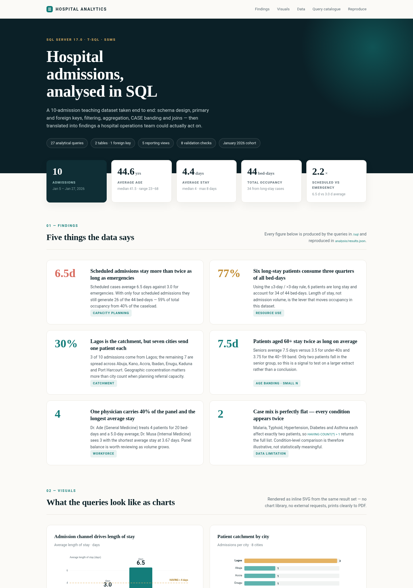
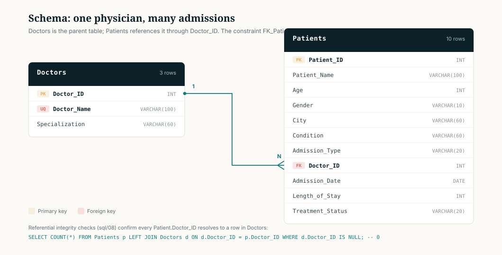
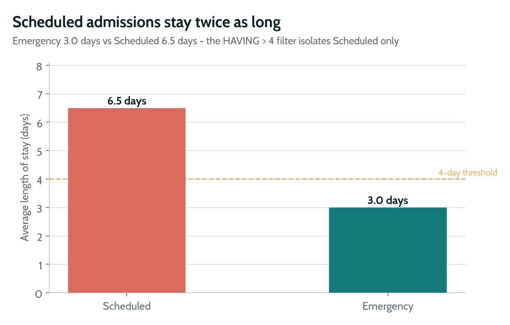
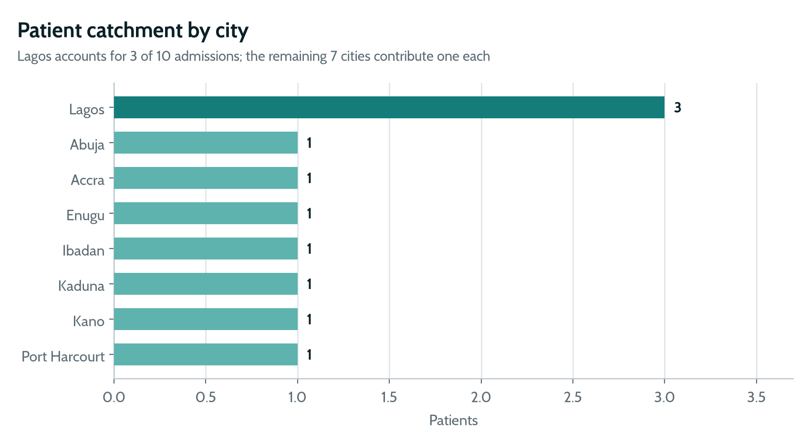
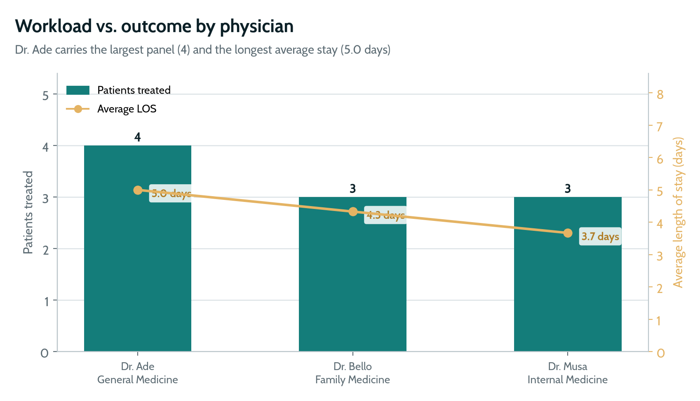
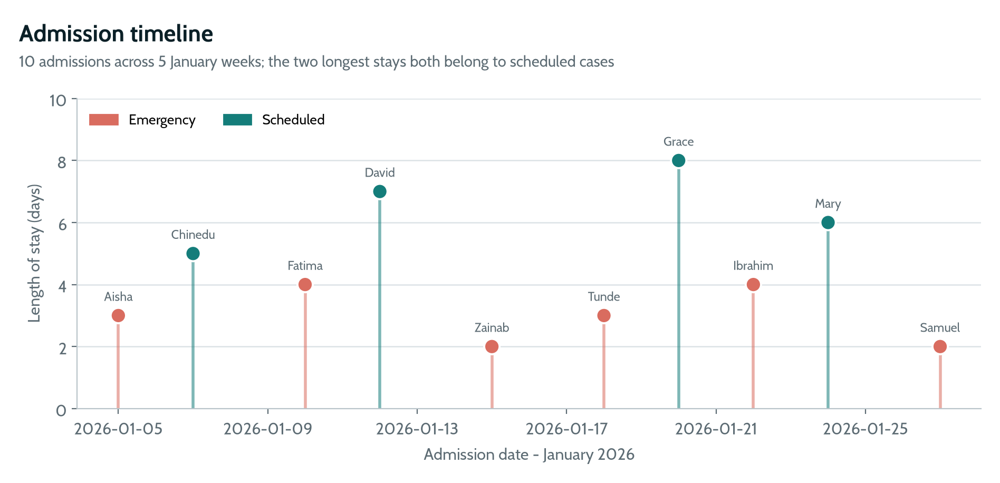

<div align="center">

# Hospital Data Analytics with SQL Server

**A complete T-SQL case study: schema design → filtering → aggregation → CASE logic → joins → findings.**

[](https://learn.microsoft.com/sql/)
[](./sql)
[](./data)
[](./docs/hospital-analytics-report.pdf)
[](./LICENSE)

[**Live dashboard**](./index.html) · [**Written report**](./docs/hospital-analytics-report.pdf) · [**Key findings**](./docs/findings.md) · [**Query catalogue**](./docs/query-catalogue.md)



</div>

---

## Overview

A 10-admission hospital extract for January 2026, taken end to end through Microsoft SQL Server. The
repository answers five assignment task sets in 27 queries, then goes one step further: it turns the
result set into a **written report** and a **visual dashboard**, so the analysis survives contact with
someone who does not read SQL.

| | |
|---|---|
| **Domain** | Hospital operations — admissions, length of stay, case mix, physician workload |
| **Engine** | Microsoft SQL Server 17.0 (compatible with 2016+ and Azure SQL) |
| **Scope** | 2 tables · 1 foreign key · 27 analytical queries · 5 reporting views · 8 validation checks |
| **Deliverables** | SQL scripts, PDF report, interactive dashboard, charts, data dictionary |

## Key findings

| # | Finding | Evidence |
|---|---------|----------|
| 1 | **Scheduled admissions stay 2.2× longer than emergencies** | 6.5 days vs 3.0 days; the `HAVING > 4` filter returns Scheduled only |
| 2 | **Six long-stay patients consume 77% of all bed-days** | 34 of 44 bed-days; 60% of patients are > 3-day stays |
| 3 | **Lagos supplies 30% of the caseload** | 3 of 10 admissions across 8 cities; 7 cities send one patient each |
| 4 | **Patients aged 60+ stay twice as long** | 7.5 days vs 3.5 (under-40) and 3.75 (40–59) — small n, treat as a signal |
| 5 | **One physician carries 40% of the panel** | Dr. Ade: 4 patients, 20 bed-days, 5.0-day average stay |

Full narrative, caveats and recommendations: [`docs/findings.md`](./docs/findings.md) and the
[PDF report](./docs/hospital-analytics-report.pdf).

## Repository structure

```text
hospital-sql-analytics/
├── index.html                     # self-contained analytics dashboard (no JS, no CDN)
├── sql/
│   ├── 00_create_schema.sql        # database, tables, PK/FK, CHECK constraints, indexes
│   ├── 01_load_data.sql            # BULK INSERT and self-contained inline load
│   ├── 02_task1_retrieving_and_filtering.sql
│   ├── 03_task2_filtering_sorting_aggregation.sql
│   ├── 04_task3_string_functions_and_dates.sql
│   ├── 05_task4_advanced_aggregation.sql
│   ├── 06_task5_keys_and_joins.sql
│   ├── 07_reporting_views.sql      # reusable reporting layer
│   ├── 08_data_quality_checks.sql  # 8 checks, each returns zero rows when clean
│   └── practice/TWDP_orders_practice.sql
├── data/
│   ├── patients.csv                # 10 admissions
│   └── doctors.csv                 # 3 physicians
├── analysis/
│   ├── run_analysis.py             # SQLite reproduction of every query + chart build
│   ├── build_dashboard.py          # generates index.html from results.json
│   └── results.json                # machine-readable query output
├── docs/
│   ├── hospital-analytics-report.pdf
│   ├── report.md
│   ├── findings.md
│   ├── data-dictionary.md
│   ├── query-catalogue.md
│   └── schema.md
└── images/                         # charts, ERD, SSMS screenshots
```

## Dataset

Ten admissions recorded between 5 and 27 January 2026, plus the three treating physicians.
Both tables are deliberately small enough to verify by hand — every number in the report can be
recomputed on paper — while still exercising the full query surface.

**Doctors** (3 rows)

| Doctor_ID | Doctor_Name | Specialization |
|---:|---|---|
| 1 | Dr. Ade | General Medicine |
| 2 | Dr. Musa | Internal Medicine |
| 3 | Dr. Bello | Family Medicine |

**Patients** (10 rows) — full register in the [data dictionary](./docs/data-dictionary.md).



> `Doctor_ID` is the primary key of `Doctors` and a foreign key in `Patients`, enforced by
> `FK_Patients_Doctors`. The integrity check returns 0 orphan rows.

## Query catalogue

The assignment's five task sets, plus the production extras that make the work reviewable.

| Set | File | Queries | Concepts |
|-----|------|--------:|----------|
| 1 · Retrieving & filtering | [`02_task1…`](./sql/02_task1_retrieving_and_filtering.sql) | 5 | `SELECT`, `WHERE`, `AND`, `BETWEEN`, `IN` |
| 2 · Sorting & aggregation | [`03_task2…`](./sql/03_task2_filtering_sorting_aggregation.sql) | 5 | `TOP`, `ORDER BY`, `DISTINCT`, `COUNT`, `AVG`, `GROUP BY` |
| 3 · Strings & dates | [`04_task3…`](./sql/04_task3_string_functions_and_dates.sql) | 5 | `UPPER`, `LOWER`, `CONCAT`, `YEAR`, `MONTH`, `DATENAME` |
| 4 · Advanced aggregation | [`05_task4…`](./sql/05_task4_advanced_aggregation.sql) | 6 | `HAVING`, `CASE`, CTE (`WITH`), banding rules |
| 5 · Keys & joins | [`06_task5…`](./sql/06_task5_keys_and_joins.sql) | 6 | PK/FK integrity, `INNER JOIN`, `LEFT JOIN`, `RANK()` |
| Extras | [`07`](./sql/07_reporting_views.sql) · [`08`](./sql/08_data_quality_checks.sql) | 5 views · 8 checks | Reporting layer, validation |

Each script is numbered for run order, quotes the expected row count in a comment, and is
idempotent where possible. Full listing: [`docs/query-catalogue.md`](./docs/query-catalogue.md).

## Visuals

| | |
|---|---|
|  |  |
|  |  |

All seven charts live in [`/images`](./images) and are rendered inline in the
[dashboard](./index.html). They are generated from `analysis/results.json`, never hand-drawn.

## How to run

**SSMS / Azure Data Studio**

1. Open and execute `sql/00_create_schema.sql` — creates `HospitalDataBase` and both tables.
2. Execute `sql/01_load_data.sql` — inline inserts, so no file-path permissions are required.
3. Run tasks `02` → `06` in order, then optionally `07` and `08`.

**sqlcmd**

```bash
sqlcmd -S localhost -E -i sql/00_create_schema.sql
sqlcmd -S localhost -E -i sql/01_load_data.sql
sqlcmd -S localhost -E -i sql/06_task5_keys_and_joins.sql
```

**Verify the load**

```sql
SELECT COUNT(*) AS Doctors  FROM dbo.Doctors;   -- 3
SELECT COUNT(*) AS Patients FROM dbo.Patients;  -- 10
```

## Reproducing the analysis without SQL Server

Every number in the report and dashboard is recomputable with Python + SQLite:

```bash
pip install pandas matplotlib
python analysis/run_analysis.py --figures   # writes results.json + images/*.png
python analysis/build_dashboard.py          # writes index.html
```

The Python layer mirrors the T-SQL logic exactly (same `CASE` bands, same filters). It exists for
convenience and CI, not as a replacement for the SQL scripts.

## Data quality

`08_data_quality_checks.sql` runs eight validations — orphan keys, duplicate keys, duplicate
admissions, nulls in critical fields, out-of-range values, domain violations, row-count reconciliation
and unused physicians. Each query is written to return **zero rows** when the data is clean, which
makes the file usable as a smoke test.

## Limitations

- **Small sample.** Ten admissions cannot support statistical inference. Percentages describe the extract, not the hospital.
- **Single month.** January 2026 only — no seasonality, no year-over-year comparison.
- **Synthetic extract.** No patient identifiers beyond an internal ID; no cost, lab or readmission data.
- **Balanced case mix** is an artefact of the dataset, not a finding about disease prevalence.
- `AVG()` needs `* 1.0` on integer columns in T-SQL; the scripts do this explicitly rather than relying on implicit conversion.

## Skills demonstrated

`Schema design` · `PK/FK & referential integrity` · `CHECK constraints` · `Filtering & sorting` ·
`Aggregate functions` · `GROUP BY / HAVING` · `CASE & CTE` · `String & date functions` ·
`INNER / LEFT JOIN` · `Window functions (RANK)` · `Views` · `Data validation` ·
`Data storytelling` · `Python/SQLite reproducibility`

## Roadmap

- [ ] Scale the extract to 12 months and 500+ admissions to test the length-of-stay findings
- [ ] Add a cost-per-bed-day column to turn occupancy into financial impact
- [ ] Publish the dashboard via GitHub Pages (Settings → Pages → root)
- [ ] Parameterise the report date range so the views work over any period

## Author

**Amandi Delight Chukwuebuka** — SQL analytics coursework, extended into a portfolio-ready case study.

## License

Released under the [MIT License](./LICENSE). The dataset is a synthetic teaching extract and contains
no real patient information.
