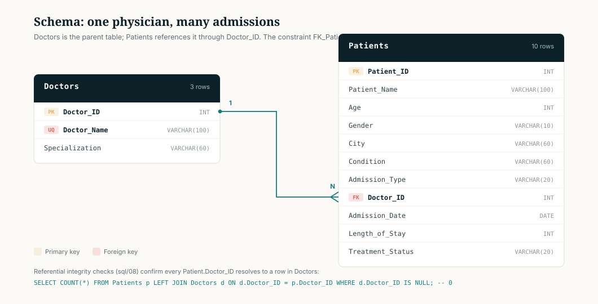

# Schema

## Design decisions

**Two tables, one relationship.** `Doctors` is the parent and `Patients` the child, linked by
`Doctor_ID`. This is the minimum viable star for the questions being asked: every analysis either
describes admissions (one table) or attributes them to a physician (one join).

**Surrogate integer keys.** `Doctor_ID` and `Patient_ID` are `INT` rather than natural keys. Names
change, and a name is not guaranteed unique across a hospital; a stable surrogate keeps joins cheap
and history intact.

**Constraints carry the business rules, not the application.** `CHECK` constraints reject an age of
200, a negative length of stay, a third gender value or an unknown admission channel at insert time.
That is why `08_data_quality_checks.sql` is able to focus on cross-row issues instead of basic domain
validation.

**Foreign key with no cascade.** Deleting a physician with admissions fails rather than silently
removing history. `FK_Patients_Doctors` is the reason the Task 5 join returns exactly the 10 expected
rows.

**Indexes follow the query workload.** Three covering-ish indexes support the three access patterns
used repeatedly: filter by city, filter by admission date, join by doctor.

## Execution order

| # | File | Purpose | Re-runnable |
|---|---|---|---|
| 00 | `00_create_schema.sql` | Database, tables, keys, constraints, indexes | yes (drops tables) |
| 01 | `01_load_data.sql` | Bulk or inline load + row-count check | yes (re-insert) |
| 02 | `02_task1_retrieving_and_filtering.sql` | Filters | yes |
| 03 | `03_task2_filtering_sorting_aggregation.sql` | Sorting, aggregation | yes |
| 04 | `04_task3_string_functions_and_dates.sql` | Strings, dates | yes |
| 05 | `05_task4_advanced_aggregation.sql` | `HAVING`, `CASE`, CTE | yes |
| 06 | `06_task5_keys_and_joins.sql` | Integrity proof, joins | yes |
| 07 | `07_reporting_views.sql` | Five reporting views | yes (`CREATE OR ALTER`) |
| 08 | `08_data_quality_checks.sql` | Eight validations | yes (read-only) |

## Reporting views

| View | Grain | Used for |
|---|---|---|
| `vw_PatientAdmissions` | one admission | Base dataset for charts and the register table |
| `vw_DoctorWorkload` | one physician | Physician scorecard (patients, bed-days, average stay) |
| `vw_ConditionSummary` | one condition | Case-mix table |
| `vw_AdmissionTypeSummary` | one channel | Channel comparison + share of caseload |
| `vw_MonthlyAdmissions` | one month | Trend reporting (single month in this extract) |

## Why views

The banding rules (age groups, stay categories) appear in three places if they are copy-pasted: the
Task 4 queries, the report and the dashboard. Defining them once in `vw_PatientAdmissions` means a
change to the senior threshold propagates everywhere — the most common source of disagreement between
a dashboard and the report it summarises.
